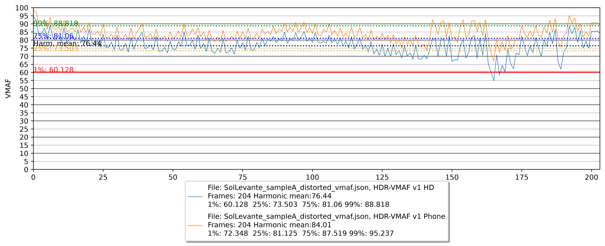
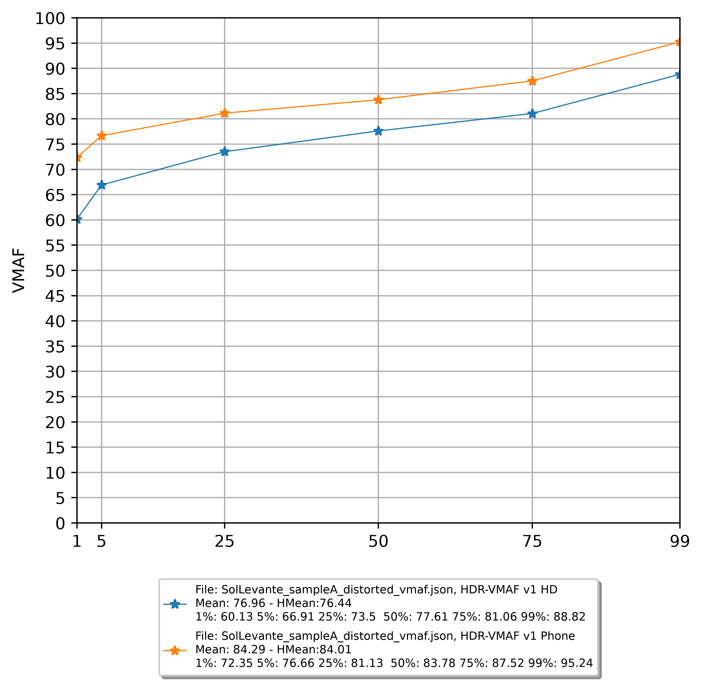
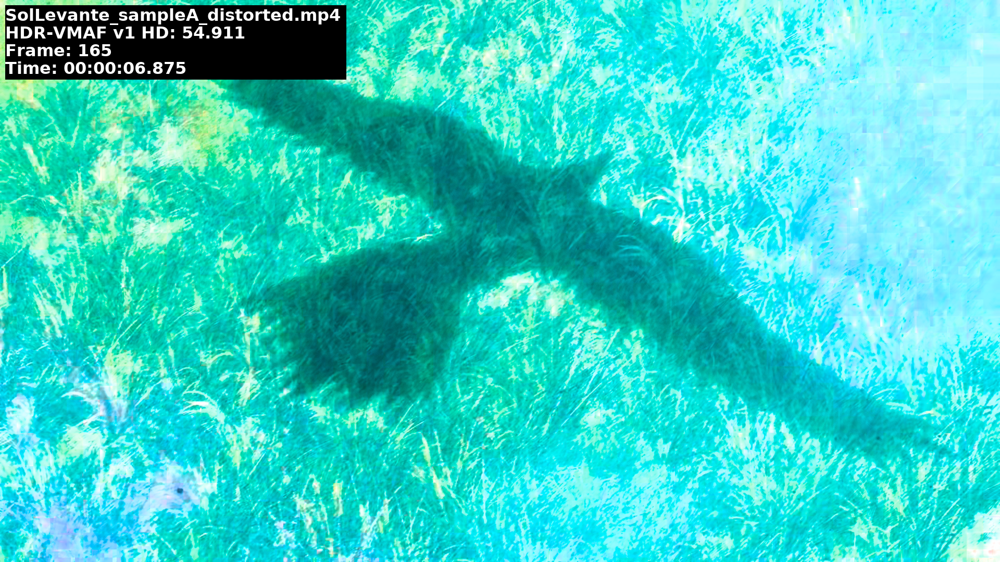
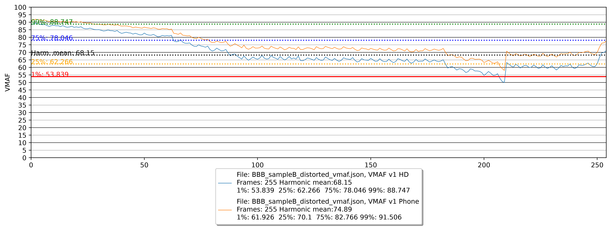
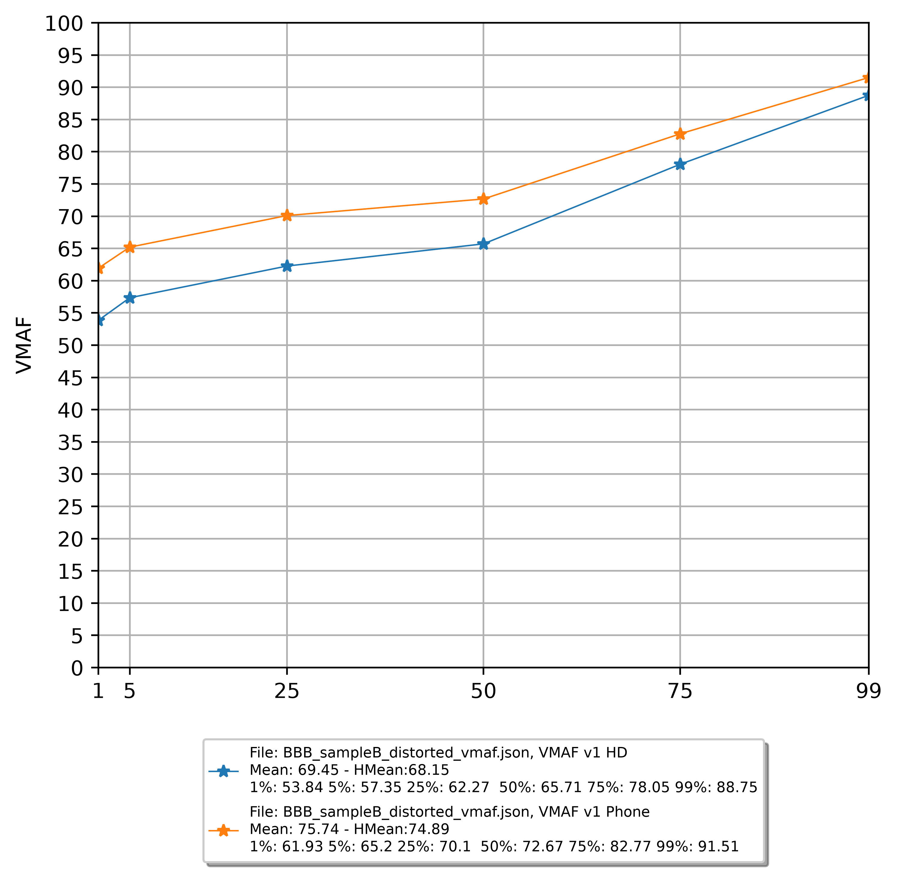
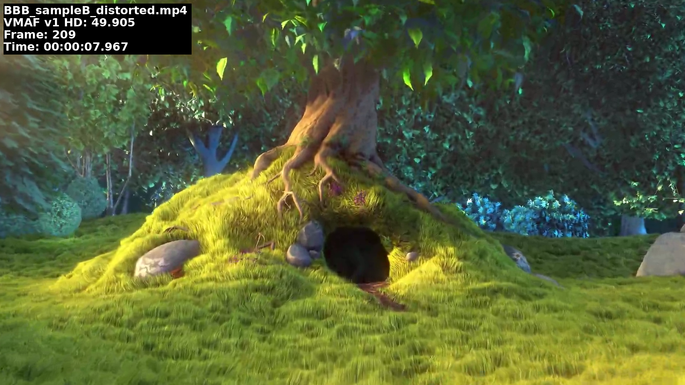
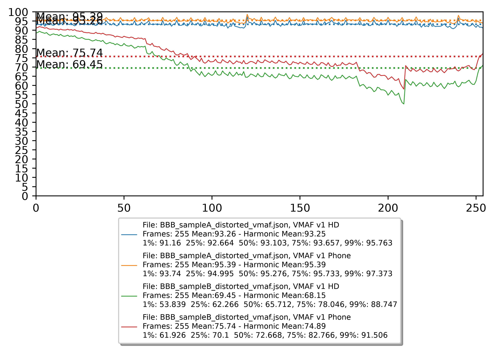
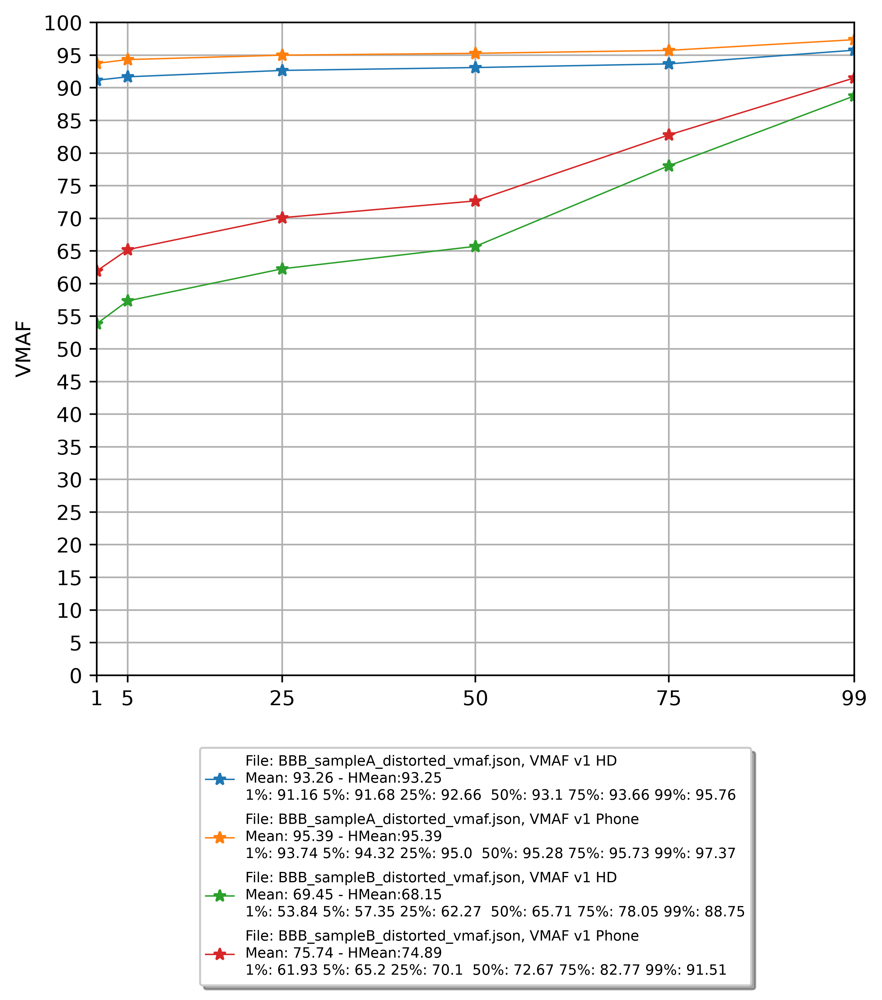

# easyVmafPlus

easyVmafPlus is an enhanced fork of [easyVmaf](https://github.com/gdavila/easyVmaf) by Gabriel Davila. It is a Python tool built on FFmpeg and ffprobe that prepares a reference and a distorted video for [VMAF](https://github.com/Netflix/vmaf). It handles deinterlacing, upscaling and downscaling, frame-to-frame syncing and frame rate adaptation. HDR (PQ) videos are scored with the HDR-VMAF models in the Docker image.

Details about how the original tool works can be found in [this OTTVerse article](https://ottverse.com/vmaf-easyvmaf/).

## What easyVmafPlus adds

| Change | Details |
|---|---|
| Hardware accelerated decoding | Every ffmpeg run passes `-hwaccel auto` to both the distorted and the reference input. When no hardware decoder is available, FFmpeg decodes in software. |
| VMAF v1 models | easyVmafPlus computes VMAF with the VMAF v1 models of libvmaf by default, in their HFR variants at 50 frames per second or more. `-vmaf_v0` runs the v0.6.1 models, `-vmaf_version 1 0.6` both generations in one run, `-view` picks the viewing distances, `-disable_hfr` and `-force_hfr` pick the standard or the HFR variants. See [VMAF models](#vmaf-models). |
| More decoders in the Docker image | The image decodes JPEG XL with libjxl, AVS2 with libdavs2 and AVS3 with libuavs3d. FFmpeg 9.0 adds Animated WebP. |
| `easyVmafPlus` command | easyVmafPlus is a Python package. `pipx install .` installs the `easyVmafPlus` command, which runs from any directory. |
| VMAF plots and low frames | `-plot` writes a temporal plot and a percentile plot per distorted file, `-low_frames` exports the frames below the 1st percentile as TIFF files, and the `easyVmafPlusPlot` command plots existing VMAF logs. See [Plots and low frames](#plots-and-low-frames). |
| Own Docker image | The Dockerfile builds FFmpeg and libvmaf from source and copies the code from this repository. The image is can be built for `linux/amd64` and `linux/arm64`. This repository offers ready built images under "Packages" |


## Features from easyVmaf

easyVmafPlus includes the features of easyVmaf up to release 5.2.0 (commit [00918ce](https://github.com/gdavila/easyVmaf/commit/00918ce64c0c600249349c3fccac56d217740298)), without the CUDA support:

* [Cambi](https://github.com/Netflix/vmaf/blob/master/resource/doc/cambi.md#options), the Netflix banding detector, is computed with `-cambi_heatmap`, which also writes the [Cambi heatmaps](https://github.com/Netflix/vmaf/issues/936). They can be viewed with [ffplay](https://github.com/Netflix/vmaf/issues/1016#issuecomment-1099591977).
* `-json` prints the results as one JSON object per distorted file on stdout.
* `-output_fmt` writes the VMAF log as `json`, `xml` or `csv`.
* The sync passes run in parallel, as many at a time as `-threads`, or one per CPU core.
* At start, easyVmafPlus checks that FFmpeg is 9.0 or later and that libvmaf runs the VMAF v1 models, or with `-vmaf_v0` its built-in models, and reports whether HDR-VMAF is available.
* Log messages go to stderr, with a timestamp.
* File paths with special characters are escaped in the libvmaf filter options.
* The command line follows the [libvmaf filter documentation](https://ffmpeg.org/ffmpeg-filters.html#libvmaf).
* With `-vmaf_v0`, the VMAF models are the built-in v0.6.1 models of libvmaf.
* With `-vmaf_v0` and the HD model, the HD, HD Neg and HD Phone scores are computed in one run.
* HDR (PQ) videos are scored with the HDR-VMAF models, see [HDR](#hdr).
* `-vmaf_version 1 0.6` computes the v1 and the v0.6.1 models in one run, `-view` picks the viewing distances of the v1 models.
* Both inputs are measured in the chroma subsampling of the reference, at 10 bits with the v1 models, or at the bit depth of `-bitdepth`.
* The CAMBI feature of the v1 models gets the size and bit depth of the distorted encode, or `-enc_size` and `-enc_bitdepth`, raised to the smallest size CAMBI accepts.
* `-model_option` sets any option of a v1 model feature.
* `-sync_offset` sets a signed manual offset, the one `-sync_only` reports.
* `-start_frame` and `-frame_count` measure a range of frames with the frame numbers and scores of the full run, see [Frame ranges and parallel jobs](#frame-ranges-and-parallel-jobs).
* `-jobs` computes VMAF in several FFmpeg processes at once and joins their logs.
* Every run writes a summary file next to the VMAF log, see [Output files](#output-files).
* Interlaced inputs are deinterlaced before scaling, and a `-reverse` sync search is field accurate.
* CTRL-C stops the running FFmpeg process and exits with code 130.

## Requirements

| Requirement | Notes |
|---|---|
| Linux or macOS | |
| Python 3.11 or later | Verified with Python 3.12 (Docker image) and Python 3.14 (macOS) |
| [pipx](https://pipx.pypa.io/) | Installs the `easyVmafPlus` and `easyVmafPlusPlot` commands, together with the Python modules [ffmpeg-progress-yield](https://github.com/slhck/ffmpeg-progress-yield), matplotlib, NumPy and Pillow |
| FFmpeg 9.0 or later, built with libvmaf 3.2.1 or later | The VMAF v1 models need libvmaf 3.2.1 or later. |
| For HDR-VMAF: FFmpeg master from commit 58584087cf with libvmaf master from commit 74f930d1, built with zimg | The Docker image has them. No release of FFmpeg or libvmaf has HDR-VMAF yet. See [HDR](#hdr). |

## Installation

```bash
git clone https://github.com/marcelpoelstra/easyVmafPlus.git
cd easyVmafPlus
pipx install .
```

pipx puts the `easyVmafPlus` and `easyVmafPlusPlot` commands in `~/.local/bin`. If that directory is not on your `PATH`, run `pipx ensurepath` once.

To remove the command again:

```bash
pipx uninstall easyVmafPlus
```

### Development

```bash
python3 -m venv .venv
.venv/bin/pip install -e '.[dev]'
.venv/bin/pytest
```

## Usage

```console
$ easyVmafPlus -h
usage: easyVmafPlus [-h] -d D -r R [-fps FPS] [-sw SW] [-ss SS] [-reverse]
                    [-sync_only] [-sync_offset SYNC_OFFSET] [-endsync]
                    [-start_frame START_FRAME] [-frame_count FRAME_COUNT]
                    [-model MODEL] [-vmaf_version {1,0.6} [{1,0.6} ...]]
                    [-vmaf_v0]
                    [-view {3h,5h,phone,1.5h} [{3h,5h,phone,1.5h} ...]]
                    [-disable_hfr] [-force_hfr] [-bitdepth {auto,8,10}]
                    [-dynamic_range {auto,sdr,hdr}] [-reference_color COLOR]
                    [-distorted_color COLOR] [-enc_size WxH]
                    [-enc_bitdepth {8,10,12}]
                    [-model_option FEATURE.OPTION=VALUE]
                    [-output_fmt OUTPUT_FMT] [-cambi_heatmap] [-plot]
                    [-low_frames] [-json] [-verbose] [-progress]
                    [-threads THREADS] [-jobs JOBS] [-subsample N]

Script to easy compute VMAF using FFmpeg. It allows to deinterlace, scale and sync Ref and Distorted video samples automatically:                         

 	 Autodeinterlace: If the Reference or Distorted samples are interlaced, deinterlacing is applied                        

 	 Autoscale: Reference and Distorted samples are scaled automatically to 1920x1080 or 3840x2160 depending on the VMAF model to use                        

 	 Autosync: The first frames of the distorted video are used as reference to a sync look up with the Reference video.                         
 	 	 The sync is doing by a frame-by-frame look up of the best PSNR                        
 	 	 See [-reverse] for more options of syncing                        

 As output, the per-frame VMAF log (<distorted>_vmaf.json) and a summary of the results (<distorted>_vmaf_summary.json) are created

options:
  -h, --help            show this help message and exit

input:
  -d D                  Distorted video, or a glob pattern for batch processing.
  -r R                  Reference video.
  -fps FPS              Video Frame Rate: force frame rate conversion to <fps> value. Autodeinterlace is disabled when setting this

synchronization:
  -sw SW                Sync Window: window size in seconds of a subsample of the Reference video. The sync lookup will be done between the first frames of the Distorted input and this Subsample of the Reference. (default=0. No sync).
  -ss SS                Sync Start Time. Time in seconds from the beginning of the Reference video to which the Sync Window will be applied from. Without -sw, the manual offset, with its sign from -reverse. (default=0).
  -reverse              If enable, it Changes the default Autosync behaviour: The first frames of the Reference video are used as reference to sync with the Distorted one. (Default = Disable).
  -sync_only            For sync measurement only. No Vmaf processing. Requires -sw.
  -sync_offset SYNC_OFFSET
                        Manual sync offset in seconds: positive trims the Reference, negative trims the Distorted video, the sign of the reported offset. Not with -sw or -ss. (default=0).
  -endsync              Activate end sync. This ends the computation when the shortest video ends. (Default: false).

frame range:
  Measure only a range of frames, numbered as in the log of the full calculation (after sync, deinterlacing and frame rate conversion). Joining the logs of consecutive ranges gives the log of the full calculation. MP4, MOV, Matroska and WebM inputs only.

  -start_frame START_FRAME
                        First frame to measure. (Default: 0).
  -frame_count FRAME_COUNT
                        Number of frames to measure; the last range of a video can have fewer. (Default: to the end).

models:
  -model MODEL          Vmaf Model. Options: HD, 4K. (Default: HD).
  -vmaf_version {1,0.6} [{1,0.6} ...]
                        VMAF generations to compute: 1 and/or 0.6. '-vmaf_version 1 0.6' computes both in one pass. (Default: 1).
  -vmaf_v0              Use the VMAF v0.6.1 models instead of the VMAF v1 models, the same as -vmaf_version 0.6. (Default: false).
  -view {3h,5h,phone,1.5h} [{3h,5h,phone,1.5h} ...]
                        VMAF v1 viewing distance in screen heights (phone = 5h). (Default: 3h 5h for HD; 1.5h 3h for 4K).
  -disable_hfr          Do not use the VMAF v1 HFR models, which are picked at an effective frame rate of 50 fps or higher. (Default: false).
  -force_hfr            Use the VMAF v1 HFR models at any frame rate. (Default: false).
  -bitdepth {auto,8,10}
                        Measurement bit depth. auto: 10 with VMAF v1 models, otherwise the reference bit depth. (Default: auto).
  -dynamic_range {auto,sdr,hdr}
                        Model family. auto: the HDR-VMAF models when either input is PQ (smpte2084), otherwise SDR. hdr forces HDR-VMAF; sdr scores every input with the SDR models. (Default: auto).
  -reference_color COLOR
                        HDR only: reference colorimetry, overriding what the file reports: a preset (hdr10, bt709) or key=value[,key=value] with the keys range, primaries, trc and matrix, e.g. trc=smpte2084.
  -distorted_color COLOR
                        HDR only: distorted colorimetry, as -reference_color.

VMAF v1 parameters:
  -enc_size WxH         VMAF v1 encoding resolution for CAMBI. (Default: distorted video size).
  -enc_bitdepth {8,10,12}
                        VMAF v1 encoding bit depth for CAMBI. (Default: from the distorted pixel format).
  -model_option FEATURE.OPTION=VALUE
                        Advanced VMAF v1 model option override, e.g. cambi.topk=0.5. Repeatable.

output:
  -output_fmt OUTPUT_FMT
                        Output vmaf file format. Options: json, xml or csv (Default: json)
  -cambi_heatmap        Compute CAMBI and write the CAMBI heatmaps. (Default: false).
  -plot                 Write the temporal plot and the percentile plot of each distorted file, and combined plots over several distorted files. (Default: false).
  -low_frames           Export the frames below the 1st percentile of the main VMAF model as TIFF files. (Default: false).
  -json                 Print the results as JSON on stdout, one object per distorted file. Logs go to stderr. (Default: false).
  -verbose              Activate verbose loglevel. (Default: info).
  -progress             Activate progress indicator for vmaf computation. (Default: false).

execution:
  -threads THREADS      number of libvmaf threads, also the number of parallel sync passes; per job with -jobs (default=0, one per CPU core, with -jobs CPU count / jobs)
  -jobs JOBS            Number of FFmpeg processes that compute VMAF at the same time, each on a range of contiguous frames, joined into one log with the same frames and scores as a single process. MP4, MOV, Matroska and WebM inputs only; not with -subsample. (Default: 1).
  -subsample N          Specifies the subsampling of frames to speed up calculation. (default=1, None).
```

`-d` accepts a glob pattern, for example `"myFolder/video-sample-*.mp4"`. easyVmafPlus then computes VMAF for every matching file against the same reference.

### Output files

| File | Location |
|---|---|
| VMAF log, `<distorted name>_vmaf.json` (`_vmaf.xml` with `-output_fmt xml`, `_vmaf.csv` with `-output_fmt csv`) | Next to the distorted video |
| CAMBI heatmaps, folder `<distorted name>_cambi_heatmap` (with `-cambi_heatmap`) | Next to the distorted video |
| Summary file, `<distorted name>_vmaf_summary.json` (`<distorted name>_sync_summary.json` with `-sync_only`) | Next to the VMAF log |
| Frame range log and summary, `<distorted name>_vmaf_f<first>-<last>.json` and `<distorted name>_vmaf_f<first>-<last>_summary.json` (with `-start_frame` or `-frame_count`) | Next to the distorted video |
| Plots `<distorted name>_vmaf_plot.png` and `<distorted name>_vmaf_histo.png` (with `-plot`) | Next to the distorted video |
| Low frames, folder `<distorted name>_vmaf_lowframes` (with `-low_frames`) | Next to the distorted video |
| Combined plots `<reference name>_vmaf_combined_plot.png` and `<reference name>_vmaf_combined_histo.png` (with `-plot` and two or more distorted files) | Next to the reference video |

easyVmafPlus never replaces a file or folder. When a name is taken, `_2`, `_3` and so on is added: a second run writes `<distorted name>_vmaf_2.json`, and its plots and low frames take that name, such as `<distorted name>_vmaf_2_plot.png`. The summary file follows the name of its log: `<distorted name>_vmaf_2_summary.json`.

## VMAF models

By default easyVmafPlus computes VMAF with the VMAF v1 models of libvmaf, described in the [libvmaf model documentation](https://github.com/Netflix/vmaf/blob/v3.2.1/resource/doc/models_v1.md). `-vmaf_v0` runs the v0.6.1 models instead, `-vmaf_version 1 0.6` both generations in one run. PQ inputs run the HDR-VMAF models, see [HDR](#hdr).

| `-model` | Default run | With `-vmaf_v0` | With HDR-VMAF |
|---|---|---|---|
| HD | `vmaf_v1_hd` (1080p, 3H), `vmaf_v1_hd_phone` (phone, 5H) | `vmaf_hd`, `vmaf_hd_neg`, `vmaf_hd_phone` | `hdr_vmaf_v1_hd` (1080p, 3H), `hdr_vmaf_v1_hd_phone` (phone, 5H) |
| 4K | `vmaf_v1_4k` (2160p, 1.5H), `vmaf_v1_4k_3h` (2160p, 3H, scores up to 110) | `vmaf_4k` | `hdr_vmaf_v1_4k` (2160p, 1.5H), `hdr_vmaf_v1_4k_3h` (2160p, 3H, scores up to 110) |

These are the score names in the VMAF log, in the summary file and in the `-json` output. `-view` keeps only the viewing distances given: `-view phone` scores the phone model alone, `-view 1.5h` with `-model 4K` the 1.5H model alone.

When the frames are compared at 50 frames per second or more, the v1 models run in their HFR variants, and the score names end in `_hfr`. The compared frame rate is the frame rate of the distorted video after deinterlacing, or the `-fps` value. Two interlaced inputs keep the standard v1 models, and so does `-disable_hfr`. `-force_hfr` picks the HFR variants at any frame rate. Above 60 frames per second a warning says that the HFR models are calibrated for 50 to 60.

### Measurement pixel format

libvmaf needs the same pixel format on both inputs.
easyVmafPlus measures both inputs in the chroma subsampling of the reference (4:2:0, 4:2:2 or 4:4:4), at 10 bits when a v1 model runs and at the bit depth of the reference with the v0.6.1 models alone.
`-bitdepth 8` or `-bitdepth 10` sets the bit depth yourself.
The format used is printed as `pix_fmt` and stored in the summary file.

### CAMBI encoding parameters

The distorted video is scaled before libvmaf, so the CAMBI feature of the v1 models gets the width, height and bit depth of the distorted encode: the size and pixel format of the distorted video, or `-enc_size WxH` and `-enc_bitdepth`.
CAMBI rejects encoding sizes below 180x150, or with both sides below 216.
easyVmafPlus then uses the smallest accepted size with the same aspect ratio, for example 267x150 for a 256x144 encode, and says so in the log.

### Model options

`-model_option FEATURE.OPTION=VALUE` sets an option of a v1 model feature, for example `-model_option cambi.topk=0.5`.
Repeat it for several options.

The v1 and HDR-VMAF model files ship with easyVmafPlus in `easyVmafPlus/models/`, under the BSD+Patent licence of libvmaf: see [easyVmafPlus/models/LICENSE](easyVmafPlus/models/LICENSE).

## HDR

easyVmafPlus scores HDR10 (PQ) videos with the HDR-VMAF v1 models of libvmaf (`hdr_vmaf_v1.1.8`).
The SDR models give no meaningful score on an HDR input.

When either input reports the PQ transfer (`color_transfer=smpte2084` in ffprobe), the run is HDR.
The HDR-VMAF models then run, and the scores are named `hdr_vmaf_v1_hd`, `hdr_vmaf_v1_hd_phone`, `hdr_vmaf_v1_4k` and `hdr_vmaf_v1_4k_3h`.
HDR-VMAF scores and VMAF v1 scores are not comparable.
easyVmafPlus tags each input with its colorimetry and libvmaf converts the pictures to the PQ, BT.2020 and ICtCp of the models.
The text output and the summary file show `dynamic range: hdr` and the colorimetry of both inputs.

| Flag | Default | Effect |
|---|---|---|
| `-dynamic_range` | `auto` | `sdr` scores every input with the SDR models, `hdr` forces HDR-VMAF |
| `-reference_color` | from the file | Colorimetry of the reference |
| `-distorted_color` | from the file | Colorimetry of the distorted video |

The colour flags take a preset, `hdr10` or `bt709`, or `key=value` pairs.
The keys are `range` (`tv`, `pc`), `primaries` (`bt709`, `bt2020`, `smpte432`), `trc` (`bt709`, `smpte2084`, `smpte170m`, `bt2020-10`, `bt2020-12`) and `matrix` (`bt709`, `bt2020nc`).
Use them when a file does not report its colorimetry, as ProRes files often do, or reports it wrong.
An SDR input against a PQ input is scored with HDR-VMAF too, with a warning: libvmaf converts the SDR input to PQ.
HLG inputs and the v0.6.1 models are not supported with HDR: the run stops with exit code 1 unless you add `-dynamic_range sdr`.

HDR-VMAF needs FFmpeg master from commit `58584087cf` and libvmaf master from commit `74f930d1` built with zimg.
The Docker image has them.
On an FFmpeg without them, an HDR input stops with exit code 1.

### HDR example

The samples `SolLevante_reference_10s.mp4` and `SolLevante_sampleA_distorted.mp4` in `video_samples/` are an excerpt of [Sol Levante (2020)](https://opencontent.netflix.com/) by Netflix Open Content, scaled to 1080p and encoded as HEVC Main10 with the PQ and BT.2020 tags of the master.
The first frame of the distorted video matches the frame at 1.5 seconds in the reference, like the SDR example above.
The run needs the Docker image:

```bash
docker run --rm -v "$PWD/video_samples:/videos" ghcr.io/marcelpoelstra/easyvmafplus -r /videos/SolLevante_reference_10s.mp4 -d /videos/SolLevante_sampleA_distorted.mp4 -sw 1 -ss 1 -plot -low_frames
```

```console
...
=======================================
Results: /videos/SolLevante_sampleA_distorted.mp4
=======================================
VMAF computed
=======================================
offset:  1.5  | psnr:  38.500124
pix_fmt: yuv420p10le | HFR: off
dynamic range: hdr
color (range/primaries/trc/matrix): reference tv/bt2020/smpte2084/bt2020nc | distorted tv/bt2020/smpte2084/bt2020nc
HDR-VMAF v1 HD:  76.95780643137255
HDR-VMAF v1 Phone:  84.29261283333334
VMAF output file path:  /videos/SolLevante_sampleA_distorted_vmaf.json
Summary file path:  /videos/SolLevante_sampleA_distorted_vmaf_summary.json
Plot output path:  /videos/SolLevante_sampleA_distorted_vmaf_plot.png
Percentile plot output path:  /videos/SolLevante_sampleA_distorted_vmaf_histo.png
Low frames output path:  /videos/SolLevante_sampleA_distorted_vmaf_lowframes
```

The summary file `SolLevante_sampleA_distorted_vmaf_summary.json`:

```json
{
  "distorted": "/videos/SolLevante_sampleA_distorted.mp4",
  "reference": "/videos/SolLevante_reference_10s.mp4",
  "sync": {
    "offset": 1.5,
    "psnr": 38.500124
  },
  "vmaf": {
    "model": "HD",
    "pix_fmt": "yuv420p10le",
    "hfr": false,
    "dynamic_range": "hdr",
    "color": {
      "reference": {
        "range": "tv",
        "primaries": "bt2020",
        "trc": "smpte2084",
        "matrix": "bt2020nc"
      },
      "distorted": {
        "range": "tv",
        "primaries": "bt2020",
        "trc": "smpte2084",
        "matrix": "bt2020nc"
      }
    },
    "hdr_vmaf_v1_hd": 76.957806,
    "hdr_vmaf_v1_hd_phone": 84.292613,
    "output_file": "/videos/SolLevante_sampleA_distorted_vmaf.json",
    "plot_path": "/videos/SolLevante_sampleA_distorted_vmaf_plot.png",
    "histo_path": "/videos/SolLevante_sampleA_distorted_vmaf_histo.png",
    "low_frames_path": "/videos/SolLevante_sampleA_distorted_vmaf_lowframes"
  }
}
```





Frame 165 of the example, the lowest scoring of its three low frames, converted to PNG for this page.
The low frames of an HDR run are converted to BT.709 limited range, because a PQ picture written as 8 bit RGB looks flat:



### HDR errors

| Message | Fix |
|---|---|
| `is HLG (arib-std-b67): HDR-VMAF only measures PQ` | Add `-dynamic_range sdr` |
| `VMAF 0.6 has no HDR models` | Drop `-vmaf_v0` and `-vmaf_version 0.6`, or add `-dynamic_range sdr` |
| `This FFmpeg build cannot compute the HDR-VMAF models` | Run in the Docker image, or add `-dynamic_range sdr` |
| `does not report its color <key>` | Add `-reference_color` or `-distorted_color` with that key, or the preset `hdr10` |
| `has color <key> <value>, which the HDR-VMAF models do not support` | Override that key with `-reference_color` or `-distorted_color` |

## Frame ranges and parallel jobs

`-start_frame N` and `-frame_count N` measure only those frames, numbered as in the log of the full run, with the same frame numbers and scores.
The log is named `<distorted name>_vmaf_f<first>-<last>.json`, its summary file `<distorted name>_vmaf_f<first>-<last>_summary.json`, and with `-cambi_heatmap` the heatmap folder gets the same `_f<first>-<last>` suffix.
Joining the logs of consecutive ranges gives the log of the full run, so a long video can be split over several machines.
Frame ranges need MP4, MOV, Matroska or WebM inputs, which seek to an exact frame, and they do not work with `-subsample`.
Without a sync offset, both videos must start at the same timestamp.

`-jobs N` runs N FFmpeg processes at once, each on a range of frames.
It joins their logs and heatmaps into the files of a single run.
Use it when one process leaves CPU cores idle, as at 4K.
Each job gets `-threads` libvmaf threads, by default the CPU count divided by the number of jobs.
Each job is a full FFmpeg process in memory.
`-progress` shows nothing with more than one job.

## Plots and low frames

`-plot` writes two plots per distorted file, next to its VMAF log:

| Plot | Content |
|---|---|
| `<distorted name>_vmaf_plot.png` | The VMAF scores per frame, a curve per model, with lines for the 1%, 25%, 75% and 99% percentiles and the harmonic mean of the first model |
| `<distorted name>_vmaf_histo.png` | The VMAF scores at the percentiles 1, 5, 25, 50, 75 and 99, a curve per model, with the mean and the harmonic mean in the legend |

The plots and the low frame on this page come from the sync example [Distorted video delayed against the reference](#distorted-video-delayed-against-the-reference), with `-plot -low_frames` added:

```bash
easyVmafPlus -r BBB_sampleA_distorted.mp4 -d BBB_sampleB_distorted.mp4 -sw 2 -ss 0 -reverse -plot -low_frames
```





With two or more distorted files, `-plot` also writes both plots over all files, next to the reference: `<reference name>_vmaf_combined_plot.png` and `<reference name>_vmaf_combined_histo.png`. The y-axis runs from 0 to 100, or to 110 on plots with `vmaf_v1_4k_3h` or `hdr_vmaf_v1_4k_3h`.

`-low_frames` exports every frame whose score of the first model (`vmaf_v1_hd`, `vmaf_v1_4k`, `hdr_vmaf_v1_hd`, `hdr_vmaf_v1_4k`, `vmaf_hd`, `vmaf_4k`, or its `_hfr` variant) lies below its 1st percentile. Each frame is an LZW TIFF file in `<distorted name>_vmaf_lowframes/`, at the resolution of the distorted video, with the file name, the score, the frame number and the time printed on it. Use it with care on long videos: it exports up to 1% of all frames.

Frame 209 of the example, the lowest scoring of its three low frames, converted to PNG for this page:



### Plotting existing VMAF logs

```console
$ easyVmafPlusPlot -h
usage: easyVmafPlusPlot [-h] [-o OUTPUT] vmaf_file [vmaf_file ...]

Plot VMAF logs of easyVmafPlus: per log the temporal plot and the percentile
plot, and with two or more logs the combined plots.

positional arguments:
  vmaf_file            VMAF log: json, xml or csv

options:
  -h, --help           show this help message and exit
  -o, --output OUTPUT  Combined plot of two or more logs; the combined
                       percentile plot gets _histo before the extension.
                       (Default: plot.png).
```

`easyVmafPlusPlot BBB_sampleA_distorted_vmaf.json` writes `BBB_sampleA_distorted_vmaf_plot.png` and `BBB_sampleA_distorted_vmaf_histo.png`. With two or more logs it also writes the combined plots to the `-o` path.

The combined plots of both sync examples, which use different references, from the logs in `video_samples/`:

```bash
easyVmafPlusPlot BBB_sampleA_distorted_vmaf.json BBB_sampleB_distorted_vmaf.json -o BBB_vmaf_combined.png
```





In the Docker image, give `-o` a path in the mounted folder. The default `plot.png` lands inside the container, which `--rm` deletes when the run ends:

```bash
docker run --rm --entrypoint easyVmafPlusPlot -v <local-path-to-your-video-files>:/<custom-name-folder> ghcr.io/marcelpoelstra/easyvmafplus /<custom-name-folder>/video-2_vmaf.json /<custom-name-folder>/video-3_vmaf.json -o /<custom-name-folder>/plot.png
```

## Sync examples

The examples use the samples in `video_samples/`. Run them from that directory.

### Reference delayed against the distorted video


The first frame of `BBB_sampleA_distorted.mp4` matches the frame at 1.5 seconds in `BBB_reference_10s.mp4`. With `-sw 1 -ss 1`, easyVmafPlus searches a sync window of 1 second, starting 1 second into the reference. It picks the offset with the highest PSNR.

```console
$ easyVmafPlus -r BBB_reference_10s.mp4 -d BBB_sampleA_distorted.mp4 -sw 1 -ss 1
...
=======================================
Results: BBB_sampleA_distorted.mp4
=======================================
VMAF computed
=======================================
offset:  1.5  | psnr:  40.032121
pix_fmt: yuv420p10le | HFR: off
dynamic range: sdr
VMAF v1 HD:  93.25625806666666
VMAF v1 Phone:  95.39317798431372
VMAF output file path:  BBB_sampleA_distorted_vmaf.json
Summary file path:  BBB_sampleA_distorted_vmaf_summary.json
```

### Distorted video delayed against the reference


Here the first frame of the reference `BBB_sampleA_distorted.mp4` matches the frame at 1.0 second in the distorted `BBB_sampleB_distorted.mp4`. The `-reverse` flag applies the sync window to the distorted video. The offset is then reported as a negative value.

```console
$ easyVmafPlus -r BBB_sampleA_distorted.mp4 -d BBB_sampleB_distorted.mp4 -sw 2 -ss 0 -reverse
...
=======================================
Results: BBB_sampleB_distorted.mp4
=======================================
VMAF computed
=======================================
offset:  -1.0  | psnr:  37.254979
pix_fmt: yuv420p10le | HFR: off
dynamic range: sdr
VMAF v1 HD:  69.45323132941176
VMAF v1 Phone:  75.73841588627451
VMAF output file path:  BBB_sampleB_distorted_vmaf.json
Summary file path:  BBB_sampleB_distorted_vmaf_summary.json
```

### JSON output

With `-json`, stdout carries one JSON object per distorted file. The log messages stay on stderr.

```console
$ easyVmafPlus -r BBB_reference_10s.mp4 -d BBB_sampleA_distorted.mp4 -sw 1 -ss 1 -json 2>/dev/null
{"distorted": "BBB_sampleA_distorted.mp4", "reference": "BBB_reference_10s.mp4", "sync": {"offset": 1.5, "psnr": 40.032121}, "vmaf": {"model": "HD", "pix_fmt": "yuv420p10le", "hfr": false, "dynamic_range": "sdr", "vmaf_v1_hd": 93.256258, "vmaf_v1_hd_phone": 95.393178, "output_file": "BBB_sampleA_distorted_vmaf.json"}}
```

## Docker image

The image `ghcr.io/marcelpoelstra/easyvmafplus` is published to the GitHub Container Registry for `linux/amd64` and `linux/arm64`. It is based on `python:3.12-slim`, with FFmpeg master, libvmaf master, zimg 3.0.6, davs2 1.7 and uavs3d 1.2 built from source, so that it scores HDR videos with HDR-VMAF. See the [Dockerfile](Dockerfile) for details.

FFmpeg in the image includes libdavs2, which is GPL, so the FFmpeg build is licensed under GPL version 3 or later. The licence texts of FFmpeg, libvmaf and zimg, and the source archive FFmpeg was built from, are listed under `/usr/local/share/licenses/` in the image. It is built from these sources:

| Component | Source |
|---|---|
| FFmpeg master 88c46fce (13-11-2026) | `https://github.com/FFmpeg/FFmpeg/archive/88c46fce27e311c73772d9b83db4047dd83b1294.tar.gz` |
| libvmaf master a6ed0f18 (02-11-2026) | `https://github.com/Netflix/vmaf/archive/a6ed0f18285cab504b779bbccb0bbaddc3bf44c2.tar.gz` |
| zimg 3.0.6 | `https://github.com/sekrit-twc/zimg/archive/refs/tags/release-3.0.6.tar.gz` |
| davs2 1.7 | `https://github.com/pkuvcl/davs2/archive/refs/tags/1.7.tar.gz` |
| uavs3d 1.2 | `https://github.com/uavs3/uavs3d/archive/refs/tags/1.2.tar.gz` |
| dav1d, libjxl | Debian 13 packages `dav1d` and `libjxl0.11` |

| Tag | Published on |
|---|---|
| `latest` | Every push to `master` |
| `sha-<commit>` | Every push to `master`, with the short commit hash |
| `<version>` | Every version tag `v*`, for example `v1.2.3` publishes `1.2.3` |

To analyse your own files, mount the folder that holds them. The VMAF log, the plots and the low frames are written next to the distorted video, so they end up in the same folder.

```bash
docker run --rm -v <local-path-to-your-video-files>:/<custom-name-folder> ghcr.io/marcelpoelstra/easyvmafplus -r /<custom-name-folder>/video-1.mp4 -d /<custom-name-folder>/video-2.mp4
```

The image contains the samples from `video_samples/`:

```text
NAME                        TIME

                           t=0
                            |
BBB_reference_10s.mp4       */-----------------------------*/
BBB_sampleA_distorted.mp4           */---------------------*/
BBB_sampleB_distorted.mp4       */-------------------------*/
SolLevante_reference_10s.mp4   */-----------------------------*/
SolLevante_sampleA_distorted.mp4       */---------------------*/
```

VMAF between `BBB_reference_10s.mp4` and `BBB_sampleA_distorted.mp4`:

```bash
docker run --rm ghcr.io/marcelpoelstra/easyvmafplus -r video_samples/BBB_reference_10s.mp4 -d video_samples/BBB_sampleA_distorted.mp4 -sw 1 -ss 1
```

VMAF between `BBB_sampleA_distorted.mp4` and `BBB_sampleB_distorted.mp4`:

```bash
docker run --rm ghcr.io/marcelpoelstra/easyvmafplus -r video_samples/BBB_sampleA_distorted.mp4 -d video_samples/BBB_sampleB_distorted.mp4 -sw 2 -ss 0 -reverse
```

HDR-VMAF between `SolLevante_reference_10s.mp4` and `SolLevante_sampleA_distorted.mp4`:

```bash
docker run --rm ghcr.io/marcelpoelstra/easyvmafplus -r video_samples/SolLevante_reference_10s.mp4 -d video_samples/SolLevante_sampleA_distorted.mp4 -sw 1 -ss 1
```

### Building the image yourself

```bash
docker build -t easyvmafplus .
docker build --platform linux/amd64 -t easyvmafplus:amd64 .
```

The FFmpeg and libvmaf commits and the zimg, davs2 and uavs3d versions are build arguments. These are the defaults:

```bash
docker build --build-arg FFMPEG_commit=88c46fce27e311c73772d9b83db4047dd83b1294 --build-arg VMAF_commit=a6ed0f18285cab504b779bbccb0bbaddc3bf44c2 --build-arg ZIMG_version=3.0.6 --build-arg DAVS2_version=1.7 --build-arg UAVS3D_version=1.2 -t easyvmafplus .
```

On an Apple silicon Mac, the `linux/amd64` build must run under QEMU emulation 

```bash
docker run --privileged --rm tonistiigi/binfmt --uninstall qemu-x86_64
docker run --privileged --rm tonistiigi/binfmt --install amd64
```

### Docker Compose

`docker-compose.yml` builds the image as `easyvmafplus:latest` and mounts `video_samples/` on `/videos`. Set `VIDEO_DIR` to mount another folder.

```bash
docker compose build
docker compose run --rm easyvmafplus -r /videos/BBB_reference_10s.mp4 -d /videos/BBB_sampleA_distorted.mp4 -sw 1 -ss 1
VIDEO_DIR=<local-path-to-your-video-files> docker compose run --rm easyvmafplus -r /videos/video-1.mp4 -d /videos/video-2.mp4
```


## Licence

MIT, see [LICENSE](LICENSE). The original easyVmaf is written by Gabriel Davila. The VMAF v1 model files in `easyVmafPlus/models/` are under the BSD+Patent licence of libvmaf, see [easyVmafPlus/models/LICENSE](easyVmafPlus/models/LICENSE). The FFmpeg build in the Docker image is GPL version 3 or later, see [Docker image](#docker-image). The HDR-VMAF model files are under the same licence as the v1 model files. The Sol Levante samples in `video_samples/` are an excerpt of [Sol Levante (2020)](https://opencontent.netflix.com/) by Netflix Open Content, scaled to 1080p and re-encoded, under the Creative Commons Attribution 4.0 International licence, see [video_samples/SolLevante_LICENSE.txt](video_samples/SolLevante_LICENSE.txt). zimg in the Docker image is under the WTFPL.
